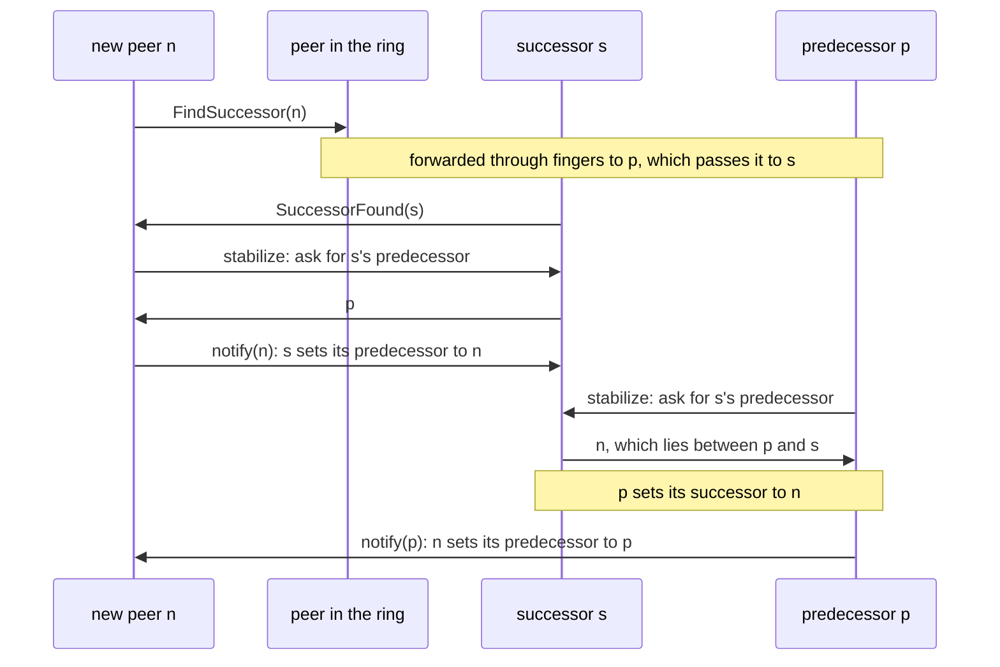

# Chord protocol in F# with Akka.NET

An implementation of the Chord peer-to-peer lookup protocol ([Stoica et al., SIGCOMM 2001](https://pdos.csail.mit.edu/papers/chord:sigcomm01/chord_sigcomm.pdf)) in a single F# script, with one Akka.NET actor per peer. A boss actor builds most of the ring directly; the remaining tenth of the peers join with Chord's join, stabilize, notify and fix_fingers procedures, and the program checks every routing entry before the lookups start. Then every peer looks up random keys, and the program prints the average number of hops per lookup.

Michael Perez and Blas Kojusner wrote it in 2021 for a course project (see [Course](#course)). It was revised in 2026 and runs on .NET 10.

## Chord in brief

Chord gives every peer and every key an m-bit identifier from SHA-1 and places them on a ring modulo 2^m. A key belongs to its successor: the first peer whose identifier is equal to the key or follows it on the ring. Each peer n keeps a finger table whose entry i points to the successor of (n + 2^i) mod 2^m. To find a key, a peer forwards the request to the finger that most closely precedes the key. Each step covers at least half of the remaining distance, so a lookup takes O(log N) hops. The paper reports an average of about ½·log2 N.

A new peer only has to ask an existing peer for its own successor. Every peer periodically runs stabilize, which ends by calling notify on its successor, and fix_fingers. Together these repair the successor pointers, predecessor pointers and finger tables as peers join.

## How the program works

`Chord.fsx` has one actor per peer and a boss actor that sets up the network and collects the results.

- The boss names the peers `peer1` to `peerN` and hashes the names to m-bit identifiers, with m = 3·⌈log2 N⌉. If two names would get the same identifier, m grows by one bit until all identifiers are distinct.
- About 90% of the peers start as a correct ring. For each of them, the boss computes the predecessor, the finger table and a successor list of ⌈log2 N⌉ entries. The other 10% join through a random peer of that ring.
- Every peer runs stabilize and fix_fingers periodically. While the ring forms, the period is 50 ms, or N/100 ms when that is longer. Once the lookups start, it is one second. Each run schedules the next one, so a busy peer never has more than one of each waiting.
- The boss asks every peer for its routing state and compares it with the correct ring for all N identifiers. When every successor, predecessor, finger and successor list is correct, the boss starts the lookups. If the number of wrong entries stops falling for many polls in a row (at least 20, and enough for three rounds of fix_fingers), the program says so and exits with code 1. There is no fixed time limit: on a slower machine the ring just takes longer to converge.
- Each peer looks up `numRequests` keys, one per second. A key is the identifier of a random 5-character string. A peer that receives a request does one of three things:
  - If it owns the key, it answers the request.
  - If the key falls between it and its successor, it passes the request to the successor, which answers.
  - Otherwise it forwards the request to the closest preceding peer in its finger table or successor list.
- The answering peer tells the requesting peer which peer was responsible and how many hops the request took. When all lookups are done, the boss prints the average. With `--verify`, the boss also checks every lookup against the true successor of its key. If peers stop reporting before all have reported (no new report for a minute plus the time the ring took to form), the program says how many are missing and exits with code 1.
- Peers know each other only as (identifier, actor reference) pairs carried in messages. The actors share no mutable state.

How a peer n joins between peers p and s:



## Running

Requires the [.NET 10 SDK](https://dotnet.microsoft.com/download/dotnet/10.0). The first run downloads Akka.FSharp 1.5.74 from NuGet.

```
dotnet fsi Chord.fsx <numNodes> <numRequests> [--verify] [--seed <n>]
```

| Argument | Meaning |
|---|---|
| `numNodes` | number of peers |
| `numRequests` | lookups per peer, one per second |
| `--verify` | check that every lookup ended at the successor of its key; exit with code 1 if one did not |
| `--seed <n>` | seed for the lookup keys; the same seed gives the same lookups and hop counts |

Example:

```
$ dotnet fsi Chord.fsx 1000 5 --verify --seed 1
Chord: 1000 peers (900 in the initial ring, 100 joining), 5 requests each
m = 30 bits, successor lists of 10, stabilize and fix_fingers every 50 ms (1 s during lookups), seed 1
Ring stable after 2.3 s: every successor, predecessor, finger and successor list is correct
Lookups: 5000 in 5.1 s
Average hops per lookup: 5.172 (max 9); 0.5 * log2(N) = 4.983
Verify: all 5000 lookups ended at the successor of their key
```

## Results

| Peers (N) | Joining | m (bits) | Lookups | Average hops | ½·log2 N | Max hops |
|---:|---:|---:|---:|---:|---:|---:|
| 100 | 10 | 21 | 500 | 3.58 | 3.32 | 6 |
| 1,000 | 100 | 30 | 5,000 | 5.17 | 4.98 | 9 |
| 5,000 | 500 | 39 | 25,000 | 6.17 | 6.14 | 11 |
| 10,000 | 1,000 | 42 | 50,000 | 6.64 | 6.64 | 11 |
| 20,000 | 2,000 | 45 | 100,000 | 7.10 | 7.14 | 13 |

Settings: 5 requests per peer, `--seed 1`. `--verify` passed in every run. With seeds 2 and 3, the averages were 5.16 and 5.19 at 1,000 peers and 7.10 and 7.10 at 20,000 peers.

A hop is one message from one peer to the next. A lookup that the requesting peer answers itself counts 0 hops. The count includes the final hop to the peer that owns the key, and routing uses the successor list as well as the fingers.

Machine: Ubuntu 24.04 desktop with an AMD Ryzen Threadripper 1920X (12 cores, 24 threads) and 31 GiB of RAM, .NET SDK 10.0.404, Akka.FSharp 1.5.74. The load average was 3 to 11 when the runs started. With all 24 threads, the three 20,000-peer runs took 26 to 30 s from start to exit, including 13 to 16 s for the ring to stabilize after the joins.

20,000 peers need several cores. With the seed-1 run limited to 4 CPUs (`taskset -c 0-3`), the ring took 116 s to stabilize and the lookups took 31 s; with 2 CPUs, they took 590 s and 202 s. The hop counts were the same.

## Continuous integration

[`.github/workflows/ci.yml`](.github/workflows/ci.yml) runs on GitHub Actions with .NET 10 on Ubuntu. It runs the program with `--verify` on rings of 1, 2 and 10 peers (2 requests per peer) and of 300 peers (3 requests per peer), and fails if any lookup does not end at the successor of its key.

## Course

COP 5615 Distributed Operating System Principles, University of Florida, Fall 2021, taught by Dr. Alin Dobra (Project 3, submitted November 3, 2021). The assignment was to implement the network join and routing from the Chord paper in F# with the actor model, one actor per peer, and a simple application that associates keys with strings. Each peer makes `numRequests` requests, one per second, and the program prints the average number of hops per request.

## Authors

- Michael Perez ([michaelperez023](https://github.com/michaelperez023))
- Blas Kojusner ([bkojusner](https://github.com/bkojusner))

## Reference

Ion Stoica, Robert Morris, David Karger, M. Frans Kaashoek and Hari Balakrishnan. "Chord: A Scalable Peer-to-peer Lookup Service for Internet Applications." ACM SIGCOMM 2001. [PDF (authors' copy)](https://pdos.csail.mit.edu/papers/chord:sigcomm01/chord_sigcomm.pdf), [doi:10.1145/383059.383071](https://doi.org/10.1145/383059.383071).
